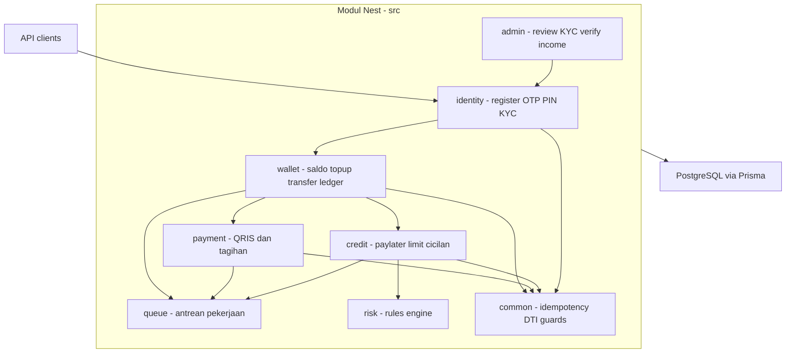

[](https://github.com/adul11s/qupi-backend/actions/workflows/ci.yml)

# qupi-backend

Backend **QUPI — QUick Payment Instrument** — fintech wallet + paylater — sebagai **monolith modular NestJS 11**.

## Arsitektur



## Struktur modul (sesuai `src/`)

| Modul | Isi |
|---|---|
| `src/identity/` | register, OTP 5 menit max 3/menit, PIN 6 digit + lockout 5x salah, KYC upload, session |
| `src/wallet/` | saldo, topup, transfer dalam & bank, ledger double-entry immutable, idempotency, row lock `SELECT ... FOR UPDATE`, store interface dengan adapter in-memory & Prisma |
| `src/payment/` | QRIS buat/status/bayar, tagihan PLN/pulsa/data inquiry + pay, provider simulator env-switch |
| `src/credit/` | PayLater: limit, aktivasi, checkout, cicilan 1/3/6 bulan, rekap, penalti |
| `src/admin/` | review KYC, verifikasi penghasilan Tier 2, operasi back-office |
| `src/queue/` | antrean pekerjaan (saat ini simulasi in-memory) |
| `src/risk/` | rules engine minimal via `RISK_RULES_JSON`, restrict mode, velocity QRIS |
| `src/common/` | guard sesi & role admin, filter domain error, idempotency + fingerprint, DTI, PIN service, Prisma service |

## Keputusan dan alasan

- **Ledger double-entry sebagai sumber kebenaran.** Saldo tidak pernah di-update sebagai field; saldo = jumlah ledger entries di `src/wallet/wallet.store.ts`. Setiap pergerakan dana adalah pasangan debit/kredit immutable, sehingga invariant saldo >= 0 bisa diverifikasi dan audit trail tersedia gratis.
- **Idempotency key + fingerprint dengan `IDEM_CONFLICT`.** Klien mengirim `Idempotency-Key`; server mencatat fingerprint intent (tujuan, jumlah, jenis) bersama key. Replay dengan intent sama mengembalikan hasil asli — tepat satu ledger entry. Key dipakai untuk **intent berbeda** ditolak `409 IDEM_CONFLICT`, bukan di-replay — mencegah salah-debit saat double-write.
- **Formula limit paylater: gaji x 2.5, plafon Rp15jt; tier 10jt/20jt berlaku untuk saldo wallet, bukan paylater.** Penghasilan tidak berdefault: tanpa verifikasi admin, limit tidak dihitung dan aktivasi ditolak (`NO_INCOME_DATA`). Di atasnya **DTI 25%**: cicilan bulanan <= 25% penghasilan, ditegakkan di semua jalur paylater (`src/common/dti.ts`).
- **Monolith modular, bukan microservices.** Satu deploy, boundary jelas di level modul Nest. Untuk pilot, biaya operasi jauh lebih kecil; boundary sudah rapi bila kelak perlu diekstrak menjadi servis terpisah.

## Trade-off sengaja diambil

- **Provider pembayaran = stub/simulator.** `PROVIDER_MODE=success|fail|timeout` meniru vendor; tidak ada integrasi produksi.
- **Antrean in-memory.** BullMQ + Redis disiapkan dependensinya, tapi pekerjaan berjalan via queue in-memory; tidak persisten antar restart.
- **Role admin sederhana.** Satu flag `isAdmin`; belum ada RBAC granular per endpoint.
- **KYC manual.** Dokumen di-review admin lewat endpoint; belum ada verifikasi otomatis/vendor.
- **`OTP_DEBUG` lokal.** Kode OTP di-echo response untuk pengembangan; wajib nonaktif di produksi.

## Known gaps (jujur)

- Kini **suite e2e Postgres (16 test) terbukti hijau di CI** — GitHub Actions service `postgres:16` (run: https://github.com/adul11s/qupi-backend/actions/runs/40162230995). Lokal tanpa Postgres tetap skip via gerbang `RUN_PG_TESTS`.
- Provider payment masih simulator; jalur vendor nyata belum teruji.
- Admin role tunggal (budget: audit log append-only sudah ada + endpoint admin baca).
- Reconciliation harian dijalankan via `scripts/reconcile.ts` (balanced=true; sample di `docs/reconciliation-sample.json`).

## Cara menjalankan & menjalankan test

```bash
cp .env.example .env            # sesuaikan DATABASE_URL
docker compose up -d            # postgres + redis
npm install
npm run db:push                 # buat schema
npm run seed                    # data demo (user, saldo, paylater, cicilan)
npm run start:dev
```

Kredensial demo: user `628123456789`, admin `62899000`, PIN `123456`.

```bash
npm test                        # semua suite in-memory, tanpa Postgres
RUN_PG_TESTS=1 npm test         # + test Postgres asli (butuh Postgres hidup & schema ter-push)
```

3 skala wajib (berjalan tanpa DB via adapter in-memory dengan mutex, semantik sama dengan row lock):

1. Lockout setelah 5 PIN salah → `test/identity.lockout.spec.ts`
2. Idempotency double-submit transfer → tepat satu ledger entry → `test/wallet.spec.ts`
3. Debit paralel 50x → saldo tidak pernah negatif → `test/wallet.spec.ts`

## What I would do next for production

1. Buktikan suite Postgres lewat CI hijau (service Postgres sudah terpasang di workflow).
2. Queue in-memory → BullMQ + Redis nyata dengan retry & dead-letter.
3. Integrasi provider pembayaran asli dengan verifikasi webhook HMAC + replay window.
4. RBAC granular + audit log semua aksi admin.
5. Observability: structured logging, tracing, metrics invariant ledger.
6. Rotasi kunci, rate limiting global, backup PITR Postgres.

## Regulatory design considerations

Kesadaran desain — bukan legal opinion — untuk dipertimbangkan saat produksi:

- **Batas saldo** sejalan dengan prinsip dompet elektronik Bank Indonesia: ceiling per tier KYC; di sini Tier 1/2 10jt/20jt untuk saldo wallet, QRIS max 2jt + velocity harian di risk engine.
- **DTI**: cicilan bulanan <= 25% penghasilan sebagai guard lending yang bertanggung jawab, konsisten dengan prinsip lending yang sehat.
- **UU PDP**: data KYC dan penghasilan sensitif — minimisasi data, enkripsi at-rest/in-transit, retensi, dan hak subjek data perlu rancangan eksplisit.
- **OJK/BI**: layanan pembayaran dan paylater berada di area regulasi OJK/BI — struktur lembaga, perizinan, pelaporan, dan perlindungan konsumen melekat hingga produksi.

## CI

`.github/workflows/ci.yml`: Node 22 → `npm ci` → `prisma validate` + `generate` → `npm run lint` → `npm run build` → `prisma db push` ke Postgres asli (service) → `npm test` dengan `RUN_PG_TESTS=1`.

## Dokumen lain

- [docs/demo-script.md](docs/demo-script.md) — demo 5 menit
- [docs/adr/](docs/adr/) — keputusan arsitektur
